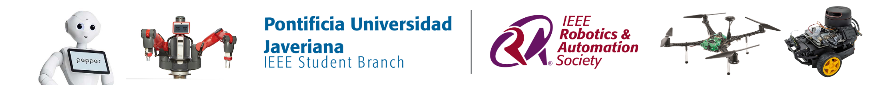

# PROJECT SENTINEL

SENTINEL is an thesis robotics project developed using **ROS 2**. The project integrates robot maneuverability, localization & navigation in real time ( SLAM ), perception complete system to acquires and process images and a full architecture able to connect, maintain, escalates all these systems ( needs to be completed and detailed by the SENTINEL's developer team ).

## Technologies

- ROS 2 Jazzy
- Ubuntu 24.04 LTS
- GO2 Edu Pro
- Gazebo Harmonic

## Project Structure

To be completed by the development SENTINEL's developer team

## Installation and Dependencies

To be completed by the development SENTINEL's developer team

## Usage

To be completed by the development SENTINEL's developer team

## Contributors

To be completed by the development SENTINEL's developer team

---

